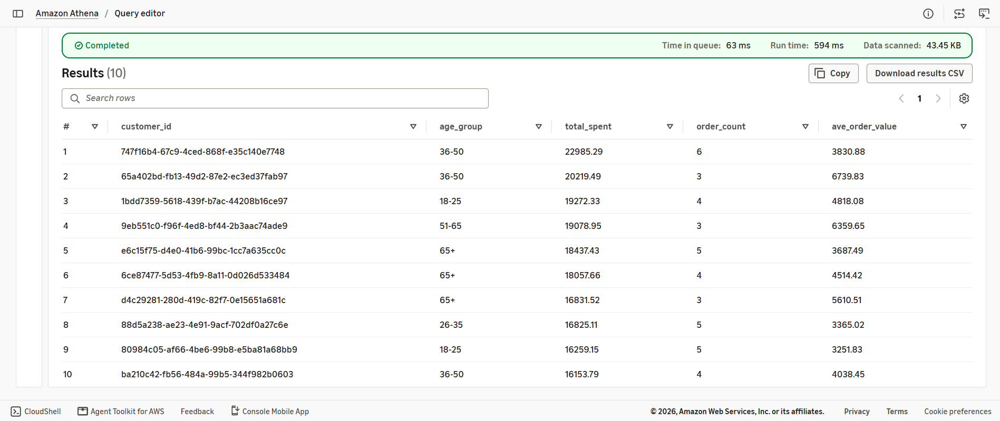
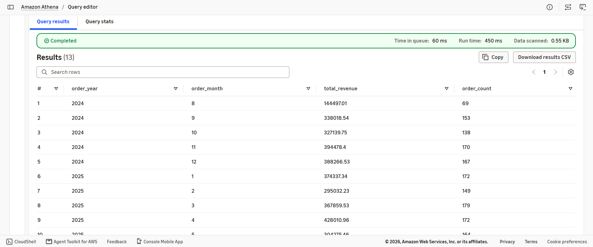
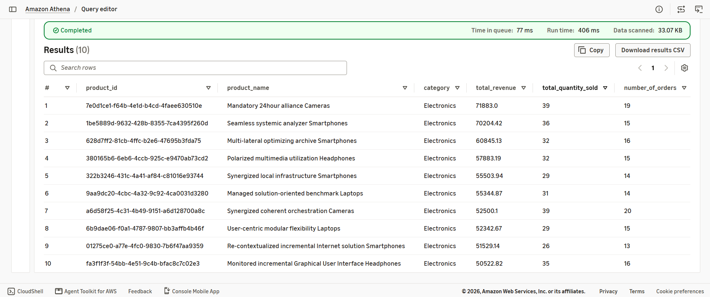

# E-commerce Data Pipeline

A batch data pipeline that ingests e-commerce data (customers, products, orders, order items, reviews) into an AWS S3 data lake, cleans and transforms it with pandas, computes business metrics, and writes the results back to S3 as Parquet — orchestrated with Prefect, deployable via Docker, queryable with Athena over Terraform-provisioned infrastructure, and covered by automated tests.

## Architecture

```
CSV files  →  S3 (raw-data/)  →  Clean & transform  →  Business metrics  →  S3 (processed/, processed/metrics/<name>/)
                                        pandas                                        Parquet (pyarrow), Prefect-orchestrated
                                                                                             │
                                                                                             ▼
                                                                      Glue Catalog + Athena workgroup (Terraform)
                                                                                             │
                                                                                             ▼
                                                                           SQL queries (sql/queries.sql)
```

- **Ingestion** (`src/data_ingestion/s3_uploader.py`): uploads raw CSVs to an S3 bucket, creating it if it doesn't exist, and verifies the upload.
- **Processing** (`src/data_processing/data_processing.py`): a plain-Python version of the ETL — downloads the raw data from S3, cleans it with pure functions (parsing dates, normalizing emails, deriving age groups/price tiers), computes customer lifetime value, product performance, and monthly sales trend metrics, then uploads the results back to S3 as **Parquet** (Athena-safe: timestamps coerced to milliseconds, no pandas `category` dtype). Each business metric gets its own S3 prefix (`processed/metrics/<name>/`) so it maps to its own Athena table.
- **Orchestration** (`src/orchestration/prefect_flows.py`): the same pipeline wrapped as a Prefect flow (`ecommerce_etl_pipeline`), with per-task retries/backoff and structured logging, so it can be scheduled and monitored via the Prefect UI.
- **Containerization**: a `docker-compose.yml` that runs a Prefect server alongside the pipeline container, so the whole thing comes up with one command.
- **Analytics infrastructure** (`infrastructure/terraform/`): Terraform-managed Glue Data Catalog database and Athena workgroup (with a per-query data-scanned cap for cost control). The S3 bucket itself is only referenced (`data "aws_s3_bucket"`), never recreated — it's already managed by `s3_uploader.py`.
- **SQL** (`sql/`): `create_tables.sql` maps each metric's S3 prefix to an external Athena table; `queries.sql` holds 3 reference queries (top customers by CLV, monthly revenue trend, product ranking by revenue).
- **Tests** (`tests/`): unit tests for the pure transform functions, `moto`-mocked S3 tests, DuckDB-based SQL logic tests, and a real-AWS integration test (excluded by default). See [Running the tests](#running-the-tests).

## Pipeline in action (S3 data lake)

**1. The S3 bucket**, split into a `raw-data/` zone for the ingested CSVs and a `processed/` zone for the cleaned output and business metrics:


**2. `raw-data/`** after the ingestion step uploads the source CSVs:


**3. `processed/`** after the transformation step — cleaned datasets plus a `metrics/` folder with the computed business metrics, each in its own Parquet-table prefix:


## Querying with Athena

*Note: the dataset behind these screenshots is synthetic/mock e-commerce data generated for this project — not real customers, orders, or personal data.*

**Top 10 customers by lifetime value:**



**Monthly revenue and order-count trend:**



**Top 10 products by revenue:**



1. Provision the Glue database and Athena workgroup (needs real AWS credentials):
   ```bash
   cd infrastructure/terraform
   cp terraform.tfvars.example terraform.tfvars   # fill in your bucket name
   terraform init
   terraform plan
   terraform apply
   ```
2. Create the tables: open the Athena query editor (or use the AWS CLI) and run [`sql/create_tables.sql`](sql/create_tables.sql), replacing `<YOUR_BUCKET_NAME>` with your bucket name.
3. Run the reference queries in [`sql/queries.sql`](sql/queries.sql) — either directly in the Athena console, or with the optional helper script:
   ```bash
   python scripts/run_athena_query.py --query-index 0   # 0 = CLV, 1 = monthly revenue, 2 = product ranking
   ```

## Tech stack

| Category | Technology |
|---|---|
| Language | Python 3.12 |
| Data processing | pandas |
| Data format | Parquet (pyarrow) |
| Cloud storage | AWS S3 (boto3) |
| Data catalog / query engine | AWS Glue Data Catalog, Amazon Athena |
| Infrastructure as code | Terraform |
| Orchestration | Prefect 3.x |
| Containerization | Docker / Docker Compose |
| Config | python-dotenv |
| Testing | pytest, moto, DuckDB |

## Project structure

```
Data_Eng_project/
├── .env.example                  # Template for AWS credentials (copy to .env)
├── data/
│   ├── raw/                      # Raw CSVs (not tracked in git, see .gitignore)
│   └── *_sample.json             # Small samples of each dataset for reference
├── sql/
│   ├── create_tables.sql         # One Athena external table per business metric
│   └── queries.sql                # Reference queries (CLV, monthly revenue, product ranking)
├── scripts/
│   └── run_athena_query.py       # Optional helper: runs a sql/queries.sql query against Athena
├── infrastructure/
│   └── terraform/                # Glue database + Athena workgroup (S3 bucket only referenced)
├── docs/images/                  # Screenshots referenced by this README
├── prefect.yaml                  # Prefect deployment config
└── data-pipeline/
    ├── requirements.txt
    ├── requirements-dev.txt      # + pytest, moto, duckdb
    ├── pytest.ini
    ├── docker-compose.yml
    ├── src/
    │   ├── data_ingestion/s3_uploader.py
    │   ├── data_processing/data_processing.py
    │   └── orchestration/prefect_flows.py
    ├── config/
    │   ├── aws_config.yaml       # S3 layout/partitioning reference
    │   └── prefect_config.yaml   # Flow/schedule reference
    ├── infrastructure/docker/Dockerfile
    └── tests/
        ├── test_data_processing.py   # Unit tests on the pure transform functions
        ├── test_s3_moto.py           # S3 functions tested against a moto-mocked bucket
        ├── test_sql_duckdb.py        # sql/queries.sql logic validated with DuckDB
        └── test_aws_connection.py    # Real-AWS integration test (pytest.mark.integration)
```

## Getting started

### Prerequisites
- Python 3.10+
- An AWS account with S3 access (Glue/Athena access too, if you want to run the Athena section)
- Docker Desktop (for the containerized run)
- Terraform >= 1.5 (only needed for the Athena infrastructure)

### 1. Set up the environment
```bash
python -m venv venv
venv\Scripts\activate          # Windows
# source venv/bin/activate     # macOS/Linux

cd data-pipeline
pip install -r requirements.txt       # runtime deps
pip install -r requirements-dev.txt   # + pytest, moto, duckdb (for the tests)
```

### 2. Configure AWS credentials
Copy `.env.example` to `.env` in the project root and fill in your own values:
```env
AWS_ACCESS_KEY_ID=...
AWS_SECRET_ACCESS_KEY=...
AWS_DEFAULT_REGION=us-east-1
AWS_S3_BUCKET_NAME=your-unique-bucket-name
```

### 3. Verify connectivity
```bash
pytest -m integration
```

### 4. Run the pipeline locally
```bash
python src/data_ingestion/s3_uploader.py      # upload raw CSVs to S3
python src/data_processing/data_processing.py # clean, transform, compute metrics, upload results as Parquet
```

### 5. Run it orchestrated with Prefect
```bash
python src/orchestration/prefect_flows.py
```
Start a Prefect server (`prefect server start`) and open http://localhost:4200 to watch the flow run, inspect task retries, and view logs.

### 6. Run it in Docker
```bash
cd ..
docker-compose -f data-pipeline/docker-compose.yml up --build -d
docker exec -it data-pipeline-data-pipeline-1 python src/orchestration/prefect_flows.py
```
This brings up a Prefect server and the pipeline container together; the Prefect UI is still at http://localhost:4200.

## Running the tests

```bash
cd data-pipeline
pytest                   # unit tests + moto-mocked S3 tests + DuckDB SQL-logic tests - no AWS needed
pytest -m integration    # real AWS connectivity check - needs valid credentials in .env
```

- **Unit tests** (`tests/test_data_processing.py`) — the pure transform functions (cleaning, age/price tiers, CLV, product performance, monthly trend) on small DataFrames, including edge cases: malformed email, null/invalid dates, null numeric values.
- **S3 tests** (`tests/test_s3_moto.py`) — `download_data_from_s3`/`upload_processed_data` exercised against a `moto`-mocked bucket, no real AWS call.
- **SQL tests** (`tests/test_sql_duckdb.py`) — runs the exact SQL text from `sql/queries.sql` through DuckDB against small local Parquet files. DuckDB's dialect is close to Athena's (both Trino/Presto-ish) but **not identical** — this validates the query logic, not full Athena-dialect compatibility.
- **Integration test** (`tests/test_aws_connection.py`) — a real AWS connectivity check, marked `@pytest.mark.integration` and excluded from the default run (see `pytest.ini`).

## Cost and cleanup

- The Athena workgroup caps data scanned per query (`athena_bytes_scanned_cutoff` Terraform variable, default 1 GiB) so exploration stays cheap.
- Athena bills by data scanned, not by table — Parquet plus one S3 prefix per metric keeps each table small and scoped.
- Query results land under `s3://<bucket>/athena-results/` and accumulate one object per query — clean that prefix out periodically.
- To tear down the Terraform-managed resources (Glue database, Athena workgroup): `terraform destroy` from `infrastructure/terraform/`. The S3 bucket is only *referenced* by Terraform, never managed, so it is never touched by `destroy`.
- Nothing in this repo runs `terraform apply`/`destroy` or a real Athena query on its own — every AWS-costing step described above is a manual command you run yourself.

## Notes

- Raw/processed data files are intentionally excluded from version control (see `.gitignore`); only small JSON samples are committed for reference.
- `config/aws_config.yaml` and `config/prefect_config.yaml` are reference templates for S3 layout and flow/schedule settings — the code itself reads the actual bucket/region from environment variables.
- `infrastructure/terraform/.terraform.lock.hcl` is committed (standard Terraform practice); the `.terraform/` plugin cache and any `*.tfstate`/`*.tfvars` are gitignored.

## Keyword checklist

Each keyword below is something this repo actually contains, not just claims:

| Keyword | Proven by | Status |
|---|---|---|
| **Parquet** | `data-pipeline/src/data_processing/data_processing.py` (`to_athena_parquet`, `to_parquet(engine="pyarrow", coerce_timestamps="ms", ...)`) | Done — verified by a local round-trip test on sample data |
| **Athena** | `sql/create_tables.sql`, `sql/queries.sql`, `infrastructure/terraform/main.tf` (workgroup + Glue database) | Done — tables created and all 3 reference queries run against real Athena (see screenshots above). |
| **Terraform** | `infrastructure/terraform/*.tf` | Done — `terraform fmt`/`validate`/`apply` all ran successfully; the Glue database and Athena workgroup exist in AWS. |
| **Prefect** | `data-pipeline/src/orchestration/prefect_flows.py` | Done (pre-existing) |
| **Docker Compose** | `data-pipeline/docker-compose.yml` | Done (pre-existing) |
| **Automated tests** | `data-pipeline/tests/*.py` (pytest, moto, DuckDB) | Done — 11 passed, 1 deselected (integration) |

**Remaining gap**: none — every keyword above is now backed by a real, verified artifact in this repo or a real AWS run.
