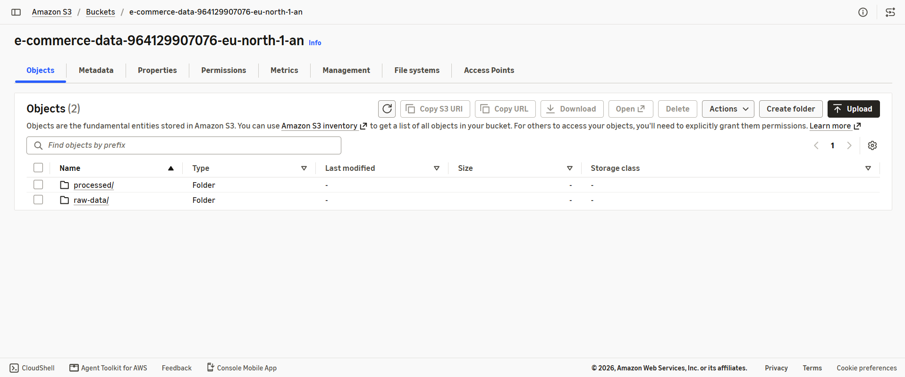
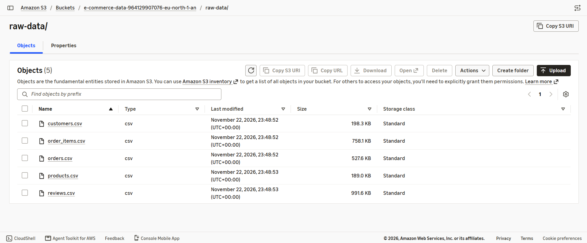
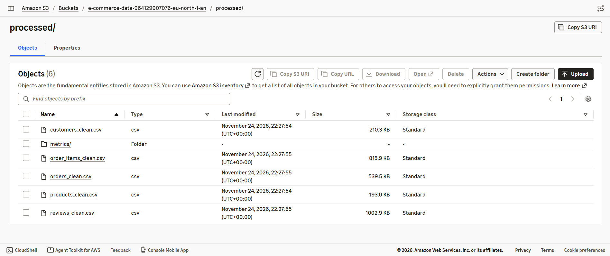

# E-commerce Data Pipeline

A batch data pipeline that ingests e-commerce data (customers, products, orders, order items, reviews) into an AWS S3 data lake, cleans and transforms it with pandas, computes business metrics, and writes the results back to S3 — orchestrated with Prefect and deployable via Docker.

## Architecture

```
CSV files  →  S3 (raw-data/)  →  Clean & transform  →  Business metrics  →  S3 (processed/)
                                        pandas                                  Prefect-orchestrated
                                                                                 Dockerized
```

- **Ingestion** (`src/data_ingestion/s3_uploader.py`): uploads raw CSVs to an S3 bucket, creating it if it doesn't exist, and verifies the upload.
- **Processing** (`src/data_processing/data_processing.py`): a plain-Python version of the ETL — downloads the raw data from S3, cleans it (parsing dates, normalizing emails, deriving age groups/price tiers), computes customer lifetime value, product performance, and monthly sales trend metrics, then uploads the results back to S3.
- **Orchestration** (`src/orchestration/prefect_flows.py`): the same pipeline wrapped as a Prefect flow (`ecommerce_etl_pipeline`), with per-task retries/backoff and structured logging, so it can be scheduled and monitored via the Prefect UI.
- **Containerization**: a `docker-compose.yml` that runs a Prefect server alongside the pipeline container, so the whole thing comes up with one command.

## Pipeline in action (S3 data lake)

**1. The S3 bucket**, split into a `raw-data/` zone for the ingested CSVs and a `processed/` zone for the cleaned output and business metrics:



**2. `raw-data/`** after the ingestion step uploads the source CSVs:



**3. `processed/`** after the transformation step — cleaned datasets plus a `metrics/` folder with the computed business metrics:



## Tech stack

| Category | Technology |
|---|---|
| Language | Python 3.12 |
| Data processing | pandas |
| Cloud storage | AWS S3 (boto3) |
| Orchestration | Prefect 3.x |
| Containerization | Docker / Docker Compose |
| Config | python-dotenv |

## Project structure

```
Data_Eng_project/
├── .env.example                  # Template for AWS credentials (copy to .env)
├── data/
│   ├── raw/                      # Raw CSVs (not tracked in git, see .gitignore)
│   └── *_sample.json             # Small samples of each dataset for reference
├── prefect.yaml                  # Prefect deployment config
└── data-pipeline/
    ├── requirements.txt
    ├── docker-compose.yml
    ├── src/
    │   ├── data_ingestion/s3_uploader.py
    │   ├── data_processing/data_processing.py
    │   └── orchestration/prefect_flows.py
    ├── config/
    │   ├── aws_config.yaml       # S3 layout/partitioning reference
    │   └── prefect_config.yaml   # Flow/schedule reference
    ├── infrastructure/docker/Dockerfile
    └── tests/test_aws_connection.py
```

## Getting started

### Prerequisites
- Python 3.10+
- An AWS account with S3 access
- Docker Desktop (for the containerized run)

### 1. Set up the environment
```bash
python -m venv venv
venv\Scripts\activate          # Windows
# source venv/bin/activate     # macOS/Linux

cd data-pipeline
pip install -r requirements.txt
```

### 2. Configure AWS credentials
Copy `.env.example` to `.env` in the project root and fill in your own values:
```env
AWS_ACCESS_KEY_ID=...
AWS_SECRET_ACCESS_KEY=...
AWS_DEFAULT_REGION=us-east-1
AWS_S3_BUCKET_NAME=your-unique-bucket-name
```

### 3. Verify connectivity
```bash
python tests/test_aws_connection.py
```

### 4. Run the pipeline locally
```bash
python src/data_ingestion/s3_uploader.py      # upload raw CSVs to S3
python src/data_processing/data_processing.py # clean, transform, compute metrics, upload results
```

### 5. Run it orchestrated with Prefect
```bash
python src/orchestration/prefect_flows.py
```
Start a Prefect server (`prefect server start`) and open http://localhost:4200 to watch the flow run, inspect task retries, and view logs.

### 6. Run it in Docker
```bash
cd ..
docker-compose -f data-pipeline/docker-compose.yml up --build -d
docker exec -it data-pipeline-data-pipeline-1 python src/orchestration/prefect_flows.py
```
This brings up a Prefect server and the pipeline container together; the Prefect UI is still at http://localhost:4200.

## Notes

- Raw/processed data files are intentionally excluded from version control (see `.gitignore`); only small JSON samples are committed for reference.
- `config/aws_config.yaml` and `config/prefect_config.yaml` are reference templates for S3 layout and flow/schedule settings — the code itself reads the actual bucket/region from environment variables.
